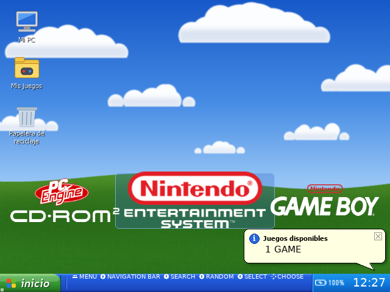
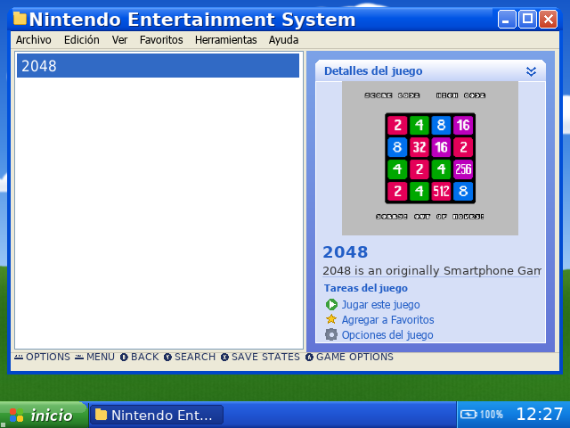
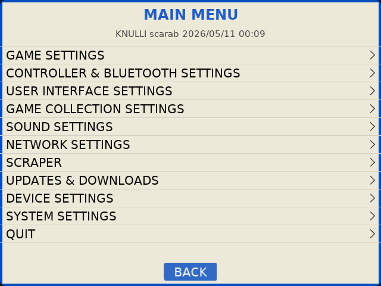

# RG35XX Pro · edición Windows XP

Un escritorio estilo **Windows XP** para la **Anbernic RG35XX Pro** con [Knulli](https://knulli.org/): tema para EmulationStation, **modo mouse** con cursor real, botones de ventana que funcionan y un **reproductor de música estilo años 2000**.

| Escritorio + reproductor | Ventana de juegos | Menú del sistema |
|---|---|---|
|  |  |  |

> Probado en RG35XX Pro (Allwinner H700), Knulli con kernel `4.9.170`. Todos los gráficos están dibujados desde cero con código (sin el fondo, logos ni skins originales de Microsoft o Nullsoft).

## Qué incluye

### `tema/es-theme-xp` — Tema "Escritorio XP"
- Escritorio con colinas y cielo, íconos (Mi PC, Mis juegos, Papelera), barra de tareas con botón **inicio**, reloj y batería en la bandeja, globo de aviso con la cantidad de juegos.
- Lista de juegos dentro de una ventana tipo Explorador: barra de título Luna, menú *Archivo / Edición / Ver…*, panel azul **Detalles del juego** con carátula y bloque **Tareas del juego**, ayuda en la barra de estado.
- Menús del sistema (Main Menu, Quick Access) con estilo de diálogo XP.
- Los logos de cada consola se toman del tema de Knulli por ruta (no se copian).
- `tema/generadores/` tiene los scripts (Python + Pillow) que dibujan todos los gráficos.

**Instalar:** copiar `es-theme-xp` a `/userdata/themes/` y elegirlo en *UI Settings → Theme Set*.

### `modo-mouse/` — Cursor real con la palanca derecha
EmulationStation en este chip no dibuja cursor (corre sobre el framebuffer con Mali, sin plano de cursor). `cursor_xp.py` lo resuelve:
- Dibuja la flecha en una **capa propia del motor de pantalla Allwinner** (`/dev/disp`), en memoria sobrante del framebuffer, sin pedir memoria al kernel.
- **Palanca derecha** mueve, **R3** hace clic (con sonido y vibración).
- Lee la pantalla para saber si estás en el escritorio o en una ventana, y hace funcionar los botones del tema: ✕ / _ cerrar y minimizar, □ jugar, **inicio** abre el menú, íconos con **selección azul y doble clic**, lista de juegos (1er clic selecciona, 2do abre), Papelera con aviso.
- Mientras está activo "agarra" el control y le pasa a EmulationStation un **teclado virtual** con todo menos la palanca derecha y R3 (así la palanca no cambia el volumen). Al abrir un juego suelta el control: los juegos siempre usan el control real como jugador 1.
- Seguridad: verifica kernel y formato de la capa antes de escribir nada, apaga la capa al salir, se esconde con un juego abierto. Nada persiste tras reiniciar.

**Instalar:** copiar la carpeta a `/userdata/system/cursor_xp/` y `Modo mouse XP.sh` a `/userdata/roms/ports/`. Se prende y apaga desde **Ports → Modo mouse XP**.

### `reproductor/` — Reproductor XP
- Ventana estilo reproductor de los 2000 (diseño propio): tiempo en LCD verde, título en marquesina, barra de progreso, ⏮ ▶ ❚❚ ■ ⏭, volumen del sistema (pactl) y lista desplegable de temas.
- Reproduce `/userdata/music` con `mpv`; se puede fijar qué temas suenan primero al prender (`armar_lista()`), el resto va en aleatorio. Se pausa solo al abrir un juego.
- Se dibuja en otra capa del motor de pantalla, solo en el escritorio. Se controla con el modo mouse.

**Instalar:** `xp_player.py` en `/userdata/system/xp_player/`, el servicio `xp_player` en `/userdata/system/services/`, agregarlo a `system.services`, y apagar la música de la interfaz (`audio.bgmusic` en `es_settings.cfg`).

### `herramientas/`
- `caratulas/`: descarga carátulas de [libretro-thumbnails](https://github.com/libretro-thumbnails) y las registra en los `gamelist.xml`.
- `pulsar.py`: simula botones del control (útil para probar sin tocar la consola).
- Lanzador de ejemplo para Counter-Strike 1.6 (port de PortMaster) con dificultad de bots fija.

## No incluido
Juegos, BIOS, música, datos de juegos de terceros (por ejemplo los de 3D Pinball) ni ningún contenido con derechos de autor. Cada uno usa sus propios archivos.

## Créditos
- [Knulli](https://knulli.org/) y EmulationStation (Batocera).
- Logos de sistemas: tema `es-theme-knulli` (GPLv3), usados por ruta desde la consola.
- Carátulas: [libretro-thumbnails](https://github.com/libretro-thumbnails).
- Hecho por Nahuel con ayuda de Claude.

Código bajo licencia MIT (ver `LICENSE`).
